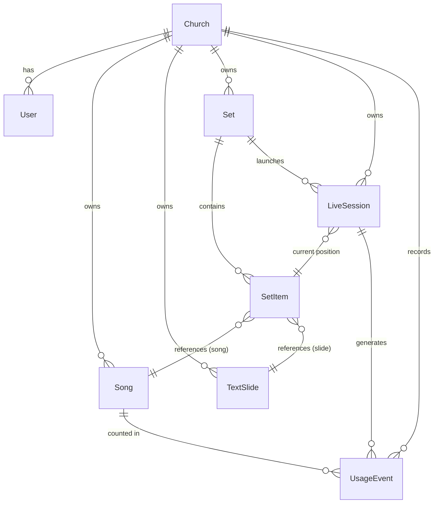
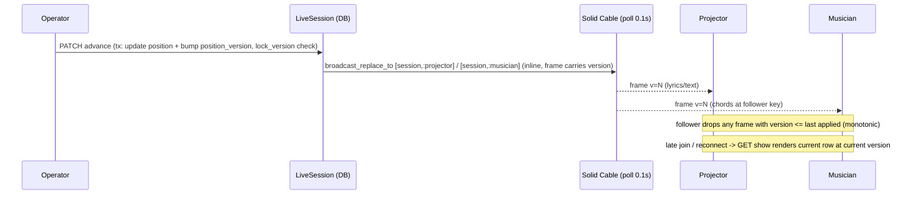

# Corobook Rewrite — Design

This design satisfies the approved `requirements.md`. Stack as scaffolded: **Rails 8.1.4,
Ruby 3.3.12, PostgreSQL, Hotwire (Turbo + Stimulus via importmap), Tailwind, Solid
Cache/Queue/Cable, Minitest + Capybara**. No models or migrations exist yet.

## 1. Overview

Corobook is a multi-tenant (two isolated churches) worship presentation app. The spine:

1. **Author** songs in ChordPro and text slides in markdown.
2. **Parse once on save** into structured JSONB (`ParsedLyric`), never re-parsing at render.
3. **Compose** a Set as an ordered list of mixed **items** (song / text slide).
4. **Drive** a live session; an operator advances position; a persisted session row is the
   source of truth; **Turbo Streams over Solid Cable** broadcast position to anonymous
   token-scoped projector and musician followers.
5. **Transpose/capo** are pure functions over the chord AST, applied per-follower.
6. **Report** CCLI usage from the live session.

Design principles: tenant isolation enforced server-side; the parsed form is derived data
(rebuildable from source); live state is small and authoritative in the DB with Cable as
transport only; views are thin and derive everything from the parsed form.

## 2. Domain model



### 2.1 Tables

> **Enum representation:** every "enum" below is a **string column + a DB CHECK constraint**,
> surfaced via Rails `enum :name, {...}`. This is deliberate over native PostgreSQL enums:
> adding a value (e.g. the future `imported_deck` item type) is then a plain migration, not an
> `ALTER TYPE`. Required Postgres extensions (enabled in migration 1): `citext`, `pg_trgm`.

**churches** — `id, name, ccli_license_number (string, null), created_at, updated_at`.
Two rows. The tenant root. Shown in the login church-picker (see §3.1).

**users** — `id, church_id (FK, not null), email (citext), password_digest, role (string +
check: admin|editor), created_at, updated_at`. Rails 8 `has_secure_password` (`bcrypt`
uncommented in the Gemfile). Unique index on `(church_id, email)` — the same email may exist
in both churches, so login is disambiguated by an explicit church choice (§3.1).

**songs** — `id, church_id (FK), title (not null), author, subtitle, reference, link,
song_key (string, null), capo (int, default 0, check 0..11), copyright_line (string, null),
ccli_song_number (int, null), copyright_status (string + check: copyrighted|public_domain|
unknown, default unknown), chordpro_source (text), parsed_lyric (jsonb),
plain_text (text — derived lyric text for search, see §8), arrangement (jsonb, null),
created_at, updated_at`. Index `(church_id, title)`; `pg_trgm` GIN index on `plain_text`.
`arrangement` is an ordered array of section labels (null = render in section order).

**text_slides** — `id, church_id (FK), title, subtype (string — statement|blessing|
statement_of_faith|question|sermon_point|scripture|announcement|…), body_markdown (text),
reusable (boolean, default true), set_id (FK, null — only for inline one-off slides),
created_at, updated_at`. Reusable slide: `reusable=true, set_id=null`; inline slide:
`reusable=false, set_id=<owning set>`. **Rendered HTML is produced on read, not stored** (no
`slides` JSONB cache — markdown rendering is cheap and a stored cache would need an
invalidation story; derive it).

**sets** — `id, church_id (FK), name, service_date (date, null), created_at, updated_at`.

**set_items** — `id, set_id (FK), position (int, check >= 0), item_type (string + check:
song|text_slide), song_id (FK, null), text_slide_id (FK, null), created_at, updated_at`.
Two nullable FKs (not Rails polymorphic) so DB FKs stay enforceable; a CHECK asserts exactly
one is set. Ordered by `position`; unique `(set_id, position)`. This is the **template**.

**live_sessions** — `id, church_id (FK), set_id (FK), status (string + check: active|ended),
current_set_item_id (FK → set_items, null), current_section_index (int, default 0),
position_version (bigint, default 0), lock_version (int, default 0 — Rails optimistic lock),
blanked (boolean, default false), font_scale (int, default 100),
projector_token (string, unique, null), musician_token (string, unique, null),
started_at, ended_at, created_at, updated_at`. The **authoritative live state** for one run of
a Set. Holding position here (not on `Set`) lets the same Set be run more than once and
re-run later without the template carrying live state. Position reads items directly from the
Set's `set_items` (no separate per-run item list — see note). Tokens are
`SecureRandom.urlsafe_base64(24)`, unique-indexed, **nulled on end** (Postgres treats NULLs as
distinct, so two ended sessions with NULL tokens do not collide). `position_version` is
monotonic (§6.2); `lock_version` guards concurrent operators (§6.5); `font_scale` and
`blanked` are broadcast projector state (§6.6).

> **No `live_session_items` table (Medium model).** The live run reads its ordered items
> straight from the Set's `set_items`, so **jump-to-any-item** (§6.2) and **operator reload
> recovery** (§6.11) both work, and a Set may be run multiple times. The tradeoff: there is NO
> spontaneous mid-service **add** of an item that isn't already in the Set — adding one would
> mutate the template. Operators pre-build the Set (including any sermon slides) before going
> live. (Requirement 6.10's "add an item mid-service" is therefore descoped to "jump to any
> item already in the Set"; see requirements note.)

**usage_events** — `id, church_id (FK), live_session_id (FK), song_id (FK),
ccli_song_number (int, null — snapshot), title (string — snapshot), author (string —
snapshot), copyright_status (string — snapshot), shown_at (datetime), created_at`. Unique
index `(live_session_id, song_id)` → one use per song per session (§7). Snapshots
denormalized so a later song edit never rewrites history.

### 2.2 Why nullable-FK items, not Rails polymorphic or STI

`set_items` could be `item_type/item_id` polymorphic, but that forfeits DB-level foreign
keys and lets an item point at another church's row. Two nullable FKs (`song_id`,
`text_slide_id`) each with a real FK constraint + a check constraint (`exactly one set`)
keeps referential integrity and tenant safety. Adding the future **imported-deck** item
type (Req 7.8) is a new nullable FK `imported_deck_id` + enum value — additive, no refactor.

## 3. Multi-tenancy (church isolation)

**Resolution:** the signed-in user's `church_id` is the tenant. Public follow views resolve
their church from the `LiveSession` the token belongs to.

### 3.1 Login church disambiguation

`users` is unique per `(church_id, email)`, so the same email can exist in both churches and
there are no subdomains (D2). The login screen therefore presents a **church picker**
(two churches → a simple select/segmented control) alongside email + password; authentication
looks up `Church#users.find_by(email:)` for the chosen church. No global-unique-email
constraint is imposed.

### 3.2 Enforcement (defense in depth)

1. Every scoped model `belongs_to :church`. Controllers never call `Song.all`; they root
   every query at `Current.church.<assoc>` (e.g. `Current.church.songs`). `default_scope` is
   deliberately **not** used (it leaks through associations and `unscoped`).
2. `Current` (`ActiveSupport::CurrentAttributes`) holds `church` and `user`, set in a
   controller `before_action`. Rails resets `Current` around each HTTP request via the
   executor.
3. **Off-request invariant (critical):** `Current` is NOT reset around Action Cable messages
   or Solid Queue jobs, so code on those paths MUST take the church/session **explicitly** and
   never read `Current.church`. Concretely: broadcasts and usage capture (§6, §7) receive the
   `LiveSession` (and thus `live_session.church`) as an argument. A model guard also asserts a
   child's `church_id` equals its parent's on save.
4. **Action Cable auth for anonymous followers:** the projector/musician pages are reached by
   a token-gated controller action (`p/:projector_token`, `m/:musician_token`) that 404s on a
   bad/ended token. The page then subscribes with `turbo_stream_from [live_session, :projector]`
   (or `:musician`). Turbo signs the **stream name**; the security property is "only a
   token-valid page is ever served the signed name," and the stream carries read-only position
   frames. No custom `ActionCable::Channel` and no `Current` on the cable path. This resolves
   the earlier §6/§3 inconsistency: we do NOT key the stream by the raw token.
5. System tests assert cross-church access returns **404** (not 403 — do not reveal existence).

This is deliberately simpler than row-level security or a tenancy gem; for two churches an
explicit `Current.church` root (on-request) plus explicit church passing (off-request) is
auditable and sufficient. RLS is noted as future hardening if tenant count grows.

## 4. ChordPro parsing and the chord AST

### 4.1 Pipeline

`chordpro_source (text)` → **`Corobook::ChordPro::Parser`** → `ParsedLyric` → serialized to
`songs.parsed_lyric (jsonb)` on every save (`before_save`). Views read JSONB only.

### 4.2 Parsed form (JSONB shape)

```json
{
  "version": 1,
  "meta": { "key": "G", "capo": 0, "title": "…" },
  "sections": [
    {
      "label": "Verso 1",
      "kind": "verse",          // verse|chorus|bridge|none (from directive, else none)
      "is_chorus": false,
      "lines": [
        { "segments": [
            { "text": "Yo soy la ", "chord": null },
            { "text": "sal de la ", "chord": "G" },
            { "text": "tierra", "chord": "D" }
        ] }
      ]
    }
  ]
}
```

A **segment** binds the chord to the text that *follows* its bracket (Req 2.1). A chord with
no following text (end of line) is a segment with empty `text`. Chord strings are stored
**as written**; parsing into a transposable structure happens in the transposer (4.4), so an
unknown token round-trips untouched.

### 4.3 Parser rules (from Req 2)

- Normalize CRLF→LF first.
- Directives: `{title}`,`{subtitle}`,`{key}`,`{capo}`,`{comment}`/`{c}` → meta/annotation;
  `{start_of_verse|sov}`,`{start_of_chorus|soc}`,`{start_of_bridge|sob}` (+ `{eov|eoc|eob}`)
  open/close sections with optional `label`/`: Label`. `{chorus}` is a chorus-**replay**
  directive: at parse time it is **materialized** into a section whose `lines` are a copy of
  the most recently defined chorus, carrying `replay_of: "<label>"` for styling. This keeps
  views thin (they read concrete lines, never resolve references) and lets §6.2 advance into
  it like any other section. If no prior chorus exists, it becomes an empty section with an
  `x_corobook_parse_warning`.
  `{transpose: n}` recorded in meta (honored as baseline in design — applied before
  per-follower transpose). Unknown directives ignored; app-emitted customs prefixed
  `x_corobook_`.
- Inline `[chord]` split: scan the line, each `[...]` starts a new segment bound to the text
  up to the next bracket or EOL. Mid-word chords supported (no word-boundary assumption).
- Blank-line grouping only when no `{so*}` directive is present (fallback).
- Never raises on malformed chord/directive — captured verbatim.

### 4.3a Round-trip and whitespace contract (Req 11.2 gate)

Migration asserts `source → parse → serialize ≡ source` per song, so the segment model must
be byte-reversible. The contract:

- A segment's `text` holds the literal characters that followed its chord (including spaces);
  serialization re-emits `[chord]` + `text` in order, so leading/trailing spaces are preserved
  by living inside `text`.
- **Consecutive chords** (`[G][D]word`) → two segments `{chord:"G",text:""}`,
  `{chord:"D",text:"word"}`; serialization of an empty-`text` segment emits just `[chord]`
  with no inserted space, so `[G][D]` round-trips exactly (distinct from `[G] [D]`, whose
  space lives in the first segment's `text:" "`).
- **Chord-only lines** (Req 2.6) → a line of empty-`text` segments; round-trips to the same
  bare `[..][..]` with no phantom lyric.
- **Load-bearing spaces** (legacy combining-ring `C°` stored as space + combining char) are
  ordinary characters inside `text`/`chord` and are never normalized.
- Section directives and `//`→directive conversions are emitted in canonical form; the
  round-trip gate compares the **re-parsed structure**, not raw bytes, for directive lines
  (so canonicalizing `{soc}` vs `{start_of_chorus}` is allowed), but compares **verbatim** for
  lyric/chord content. This split is stated so the converter (§4.5) and parser agree.

### 4.4 Chord model and transposition/capo (Req 4)

**`Corobook::Chord`** — a value object parsed lazily from a chord string:
`{ root, accidental, quality, extension, bass }` via a regex that recognizes
`[A-G](#|b)?(m|maj|min|dim|aug|°|sus|…)?(digits)?(/bass)?`. If the regex fails → `unparsed`
flag; transpose returns it unchanged (Req 4.4).

- **Transpose(semitones):** map root (and bass) through the 12-note scale, preserving
  accidental spelling preference from the target key (sharps vs flats chosen by key
  signature); quality/extension untouched (Req 4.2).
- **Target key:** `semitones = interval(song_key → target_key)`; requires `song_key`
  (`meta.key`). If absent, UI offers only semitone shift (Req 4.1).
- **Capo(n):** display chords as if transposed `-n` semitones (shapes a capoed guitarist
  plays), with a label "Capo n (sounding key X)". Pure display; sounding key unchanged
  (Req 4.3).
- All pure functions: `(ParsedLyric, semitones, capo) → ParsedLyric'` with no DB write
  (Req 4.5). **Single implementation, Ruby, server-side for every view** (operator and
  musician) — there is deliberately NO parallel JavaScript transposer (see §6.3). The
  follower's chosen key/capo lives in their browser (Stimulus value + localStorage) and is
  sent as a request/subscription param; the server renders that follower's frame at their key.

### 4.5 Legacy converter (migration only — Req 2.8, §9)

**`Corobook::Legacy::ChordProConverter`**: column-aligned blob → ChordPro. Separate from the
live parser. Handles: CRLF; expand tabs to spaces (fixed tab stop) before column math;
Unicode **grapheme-column** width (not bytes) so accented caps align; detect chord lines
(token heuristic) vs lyric lines; for each chord, map its start column to the grapheme index
in the following lyric line and emit `[chord]` before that grapheme; convert leading/trailing
`//` to `{soc}`/`{eoc}` (or an `x_corobook_repeat` marker where ambiguous); map legacy
`[LABEL]` section headers to `{start_of_verse: LABEL}`; map the legacy `order` field to
`arrangement`. Ambiguous alignment → nearest word boundary, backstopped by the round-trip
check. Only runs during migration (Req 11).

## 5. Rendering (Req 3)

Three Hotwire views, all deriving from `parsed_lyric`:

- **Projector** (`projector#show`, token): current item only. Song → lyric text of the
  current section, chords stripped, `//` stripped, auto-fit (Stimulus `fit` controller scales
  font to fill without overflow). Text slide → rendered markdown styled by subtype. Copyright
  notice (Req 3.2) rendered on the song's final section for `copyright_status=copyrighted`,
  composed from `copyright_line` + church `ccli_license_number`. `blanked=true` → black.
- **Musician** (`musician#show`, token): song → chords+lyrics, transposed/capoed by the
  follower's chosen key (params/localStorage), current-key badge; text slide → same content
  as projector, no chord staff.
- **Operator** (`operator#show`, authenticated): musician content for the current item + a
  control bar (prev/next, blank, font ±, preview-next pane, **jump to any item in the Set**,
  end session) and a "LIVE vs STAGED" indicator. `blank` and `font ±` update
  `blanked`/`font_scale` on the session and broadcast to the projector; preview/staged is
  operator-local client state only (not persisted, not broadcast).

Markdown: render with a safe renderer (e.g. `redcarpet`/`commonmarker`) with HTML escaping;
slide subtype drives a CSS class only.

## 6. Live sync (Req 6)

### 6.1 Authority and transport

The `LiveSession` row is authoritative. An operator action (`PATCH operator/advance` etc.)
updates the row **and bumps `position_version` in one transaction**, then **broadcasts
inline** (synchronously in the request via `Turbo::StreamsChannel.broadcast_replace_to`) —
NOT through a Solid Queue job. Inline broadcast removes a Solid-Queue poll hop (lower latency)
and avoids the off-request `Current` tenancy trap (§3.2): the action already holds
`live_session` and passes `live_session.church` explicitly.

**Transport = Turbo Streams over Action Cable**, backed by **Solid Cable in production**
(`polling_interval: 0.1s`, `message_retention: 1.day`; dev `async`, test `test`). Solid Cable
is DB-backed polling, so realistic end-to-end latency is ~150–400 ms — comfortably within the
~1 s soft target (Req 6.2), but it is polling, not push; the design does not claim push.

Followers subscribe with `turbo_stream_from [live_session, :projector]` /
`[live_session, :musician]` — Turbo signs the **stream name**; the token-gated controller
action is the access check (§3.2.4). The stream name never contains the raw token or an
internal id in a guessable form.



### 6.2 Position model and ordering

Position is `current_set_item_id` (→ `set_items`, the Set's ordered list) + `current_section_index`.
Advance/rewind walks the current item's ordered sections (song: `arrangement` order if present
— resolving each label to its materialized section, including replays — else section order;
text slide: its slide order). Crossing an item boundary moves to the next `set_items.position`
and resets the section index (Req 6.5). A song becoming current triggers usage capture (§7).

**Monotonic ordering (fixes backward-flash under rapid advance):** every advance bumps
`position_version` (bigint) in the same transaction; every broadcast frame carries it. The
follower Stimulus controller stores the last applied version and **drops any frame whose
version ≤ it**. This makes out-of-order Cable delivery harmless and makes late-join/reconnect
deterministic (the GET renders the current version; a stale in-flight frame is ignored). Req
6.7's "never flash backward to the congregation" depends on this guard.

**Jump (Req 6.10, descoped):** the operator may jump `current_set_item_id` to any item already
in the Set. There is no spontaneous mid-service **add** of an item not in the Set — that would
mutate the template (Medium model, §2.1). Operators pre-build the Set, sermon slides included.

### 6.3 Per-follower key — server-side render (Req 6.6)

A musician's chosen key/capo lives in their browser (Stimulus value + localStorage). On
connect and on each frame the musician view renders **server-side** at that follower's key
using the single Ruby transposer (§4.4) — there is NO JavaScript transposer. "N per-key
renders" is a handful of musicians × a microsecond pure-function over a small JSONB blob;
paying it buys one implementation and one test suite instead of two that can silently diverge
on enharmonic spelling. The key choice is fully independent of the operator and other
musicians and is preserved across position/item changes because it is re-applied on every
render from the follower's own stored value.

### 6.4 Resilience (Req 6.7, 6.11)

- **Reconnect:** Turbo/Action Cable auto-reconnects; on `connected()` the follower re-requests
  the current frame (or the controller simply keeps the last DOM). Projector **never** renders
  an error/spinner — on disconnect it holds the last frame (freeze), a Stimulus controller
  swallows the reconnecting state.
- **Operator reload:** `operator#show` reads the `LiveSession` row and renders current
  position — cold reload lands exactly where they were.
- **End session:** status→ended, tokens nulled; follower streams render a neutral "service
  ended" state; tokens 404 thereafter.

## 7. CCLI usage (Req 9)

On a song becoming current in an active session, a `UsageEvent` is created **idempotently**:
unique index `(live_session_id, song_id)` → navigating back to a song does not double-count
(one use per song per session). Public-domain songs are skipped. The report (Req 9.6) is
`UsageEvent.where(church:, shown_at: range).where.not(copyright_status public_domain)
.group(:ccli_song_number,:title,:author).count` → CSV. Copyright notice uses the church's
`ccli_license_number`; absence of a license or `copyright_status=unknown` → notice suppressed
with an editor-facing warning, never a wrong notice.

## 8. Search (Req 8)

Search matches title, author, and **lyric text**. Lyric text is NOT searched by `ILIKE` over
the `parsed_lyric` JSONB (slow, awkward); instead each save derives a flat **`songs.plain_text`**
column — the concatenated lyric text of all segments, chords and directives stripped — and
search runs `ILIKE`/`pg_trgm` over `title`, `author`, `plain_text`, rooted at
`Current.church.songs`. A `pg_trgm` GIN index on `plain_text` keeps it fast; no full-text
engine, no FTS config (Req 8.3). Browse is an alphabetical, paginated list of the church's
songs. Text slides are searchable by `title`/`subtype`/`body_markdown` with the same `ILIKE`.

## 9. Controllers & routes (sketch)

```
# auth
get   "login"  => "sessions#new"      # church picker + email + password (§3.1)
post  "login"  => "sessions#create"   # look up chosen church's user by email
delete "logout" => "sessions#destroy"

# authenticated (church-scoped via Current.church)
resources :songs            # CRUD, ChordPro editor, derived plain_text
resources :text_slides      # CRUD (reusable)
resources :sets do          # CRUD + item ordering
  resources :set_items, only: [:create,:update,:destroy]  # reorder via position
  post :launch              # -> creates LiveSession (seeds position at first item), redirect to operator
end
resources :users            # admin only
resource  :church           # admin only (name, CCLI #)
get  "songs/search"         # ILIKE over title/author/plain_text
get  "reports/usage"        # CSV export (admin/editor, church-rooted)

# operator (authenticated, owns the session; lock_version guards concurrent operators)
get   "operator/:id"            => "operator#show"
patch "operator/:id/advance"    ; patch "operator/:id/back"
patch "operator/:id/goto"       # jump to any set_item/section in the Set
patch "operator/:id/blank"      ; patch "operator/:id/font"
patch "operator/:id/end"
# (no add_item: the Medium model forbids mutating the Set mid-service — §2.1)

# public follow (token-gated action; subscribes via signed turbo_stream_from, §3.2.4)
get "p/:projector_token" => "projector#show"
get "m/:musician_token"  => "musician#show"
```

## 9. Error handling

- Parser never raises on content; it captures malformed tokens verbatim. A truly
  unparseable *structure* (e.g. unbalanced `{soc}`) yields a section with a captured
  `x_corobook_parse_warning` and the editor sees a non-blocking warning.
- Cross-tenant access → 404.
- Token for an ended session → 404 with a neutral page.
- Migration converter failures → collected and reported per song (Req 11.2), never silent.
- Broadcast failure does not corrupt state: the DB row is authoritative, so a missed frame is
  self-healing on the next advance or reconnect.

## 10. Testing strategy (Req 10.1)

- **Unit:** `ChordPro::Parser` (directives, mid-word chords, malformed tokens, CRLF, empty
  sections, `{chorus}` replay materialization); `Chord` + transposer (quality/extension
  preserved, unknown unchanged, target-key needs source key, enharmonic spelling by key);
  capo; `Legacy::ChordProConverter` (tabs, Unicode columns, `//`, labels, `order`→arrangement);
  **round-trip serialization** (consecutive chords, chord-only lines, load-bearing spaces).
- **Model:** tenant isolation (child church must match parent), `set_items` exactly-one-FK
  check, usage dedupe unique index, token uniqueness + NULL-on-end, `capo 0..11` check,
  `position_version` monotonic bump, `lock_version` optimistic-lock conflict.
- **Integration/controller:** auth + **church-picker login** (same email in both churches
  resolves to the chosen one); role gates; cross-church 404; **off-request tenancy** (a
  broadcast/usage path never reads `Current.church`); CSV report shape; search over
  `plain_text`.
- **System (Capybara):** author a song; build a mixed Set; launch; operator advance →
  projector/musician update (Turbo Stream); **rapid advance does not flash backward**
  (version guard); blank/font toggle broadcasts to projector; per-musician independent key;
  late join sync; operator reload recovery; copyright notice on projection. Cable adapter in
  test is `test`; use Turbo Stream assertions + `assert_broadcasts`.

## 11. Build order (feeds tasks.md)

Mirrors Req ordering, each step green + committed, migration LAST:
1. Foundation: docker-compose Postgres, enable `citext`/`pg_trgm`, `db:prepare`,
   Minitest/Capybara smoke, CI, uncomment `bcrypt`.
2. Tenancy + auth: Church, User, `Current`, church-picker login, role gates, cross-church
   404 tests, off-request tenancy invariant.
3. ChordPro parser + chord AST + transposer/capo (pure, fully unit-tested, single Ruby
   implementation) — the riskiest piece, proven before any UI.
4. Song CRUD + ChordPro editor + derived `plain_text` + the three derived renderings
   (static, no live yet).
5. Text slides (reusable + inline) + subtype styling.
6. Sets + set_items ordering (mixed items). Search over title/author/plain_text.
7. Live session + Solid Cable broadcasting: operator/projector/musician, position_version
   ordering, lock_version, blank, font, preview, jump-to, freeze-on-drop, reload recovery.
8. CCLI: copyright notice rendering, usage capture, CSV report.
9. **Migration (last):** legacy converter + importer with per-song round-trip gate.

## 12. Key decisions & rationale

- **Nullable-FK set items** over polymorphic/STI → keeps DB FKs + tenant safety; future
  imported-deck type is additive (string+check enums make the new value a plain migration).
- **Explicit `Current.church` rooting** on-request + **explicit church passing off-request**
  (jobs/Cable) over `default_scope`/RLS/gem → auditable, leak-proof for two tenants; RLS noted
  as future hardening.
- **Single Ruby transposer, server-side for every view** (no JS copy) → one implementation,
  one test suite; avoids enharmonic-spelling drift between two transposers. Per-follower key
  is re-rendered server-side on each frame — N is a handful of musicians, cost negligible.
- **DB row as live-session authority, Cable as transport** → survives reload/restart; a
  dropped frame is self-healing; `position_version` makes out-of-order frames harmless so the
  congregation never sees a backward flash; `lock_version` guards concurrent operators.
- **Medium live-session model** (position on `LiveSession`, items read from the Set, no
  `live_session_items`) → a Set is re-runnable and reload-recoverable, at the cost of no
  spontaneous mid-service add; operators pre-build the Set.
- **Inline broadcast, not Solid Queue** for position pings → one fewer DB-poll hop and no
  off-request `Current` trap.
- **Parse-once JSONB with `{chorus}` replays materialized** → no render-time re-parse, thin
  views, transposition is a pure function; legacy parser quirks confined to a one-time
  converter governed by an explicit round-trip/whitespace contract.
- **`plain_text` derived column + `pg_trgm`** → lyric search without ILIKE-on-JSONB or an FTS
  engine.
- **Snapshotted usage events** → CCLI history immune to later song edits.
